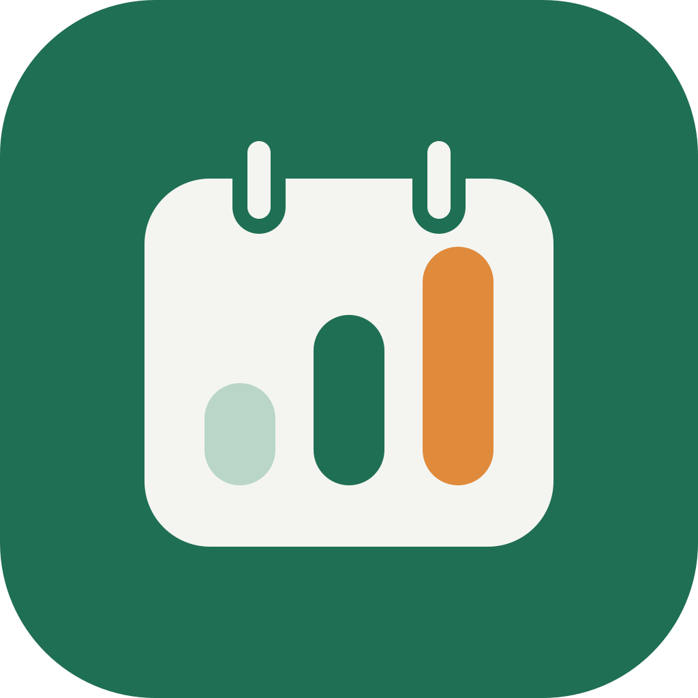

<p align="center"></p>

<h1 align="center">Money Tracker</h1>

Track your spending day by day, month by month, with fixed subscriptions (monthly and every 3 months) tracked on their own.

Built with **Vue 3 + TypeScript + Vite + Pinia**, packaged as a mobile app with **Capacitor**. Data is stored on the device with `@capacitor/preferences` (localStorage in the browser).

## Screens

- **Overview**: month total against your budget, what's left, per-day allowance, daily bar chart, recent days
- **Day**: one day's expenses, category split, under/over the daily budget
- **Add / edit expense**: keypad, daily categories (breakfast, lunch, gas, car, wife, children, home needs…) and monthly bills (mobile, internet, electricity, water, rent…)
- **Calendar**: month heatmap with average, last 7 days, highest day and over-budget days
- **Fixed**: monthly and every-3-months subscriptions, mark as paid, next due dates, the next 3 months, and a switch to count them in the budget
- **Income**: a yearly view of what comes in, split four ways:
  - **Fixed monthly**: salary or any fixed amount every month, with start and optional end
  - **Yearly investments**: an amount invested at the yearly return % you choose (e.g. 25%), counted month by month
  - **Deals**: amount invested, profit earned (as an amount or a % of what was invested), start and end; a yearly deals report (deals closed, invested, earned, return %) counts each deal in the year it ends
  - **Personal projects**: a cafe, restaurant or side business, logging earnings and costs by date for its net profit per month and year
- **Rewards** (card on Overview): a reward pot kept apart from the monthly budget, filled by the other apps on the same account:
  - **Azkar Tracker**: each 1000-round of a dhikr finished in the counter
  - **Workout Tracker**: every 30 days with a logged workout, in total (rest days don't reset it; past workouts count)
  - Set each reward's amount in Settings (0 turns it off). A reward keeps the amount it was earned at, and an undone round or deleted workout takes its reward back.
  - Turn on **Pay from rewards** when adding an expense to pay it from the pot; it then doesn't count against the budget.
- **Budget warning** (Overview): once the month passes a share of the budget (80% by default, set in Settings, or off), a card says how much is used and what's left per day, and flags a day that went over its own budget
- **Due soon** (Overview): unpaid fixed subscriptions due in the next few days
- **Bill reminders** (iPhone, Settings): a notification at 9:00 on the day, or 1, 2, 3 or 7 days before, for each unpaid fixed subscription; tapping it opens Fixed
- **Categories** (Settings): add your own, rename built-in ones, change icon and colour, or hide them from the picker (past expenses keep them). Synced with the rest
- **Accounts** (Settings, or the card on Overview): cash, bank accounts, cards and wallets (InstaPay, Vodafone Cash…). Each starts from the balance you type; expenses paid with it take money out, and **Move money** records transfers between accounts or money coming in (salary, gifts). Transfers never count as spending. **Set balance** corrects an account to what's really in it
- **Expense details**: the store (suggested from past ones), the account it was paid with (defaults to the last one used), and a receipt photo. Photos stay on the device that took them and aren't synced
- **Savings goals** (Settings, or the card on Overview): a target and optional date, money put aside or taken out, and how much a month reaches the target on time. Kept apart from the budget
- **Export** (Settings): expenses as CSV, or a full JSON backup of everything; the backup asks for the Income password if one is set
- **Settings** (gear on Overview): monthly budget, currency and reward amounts
- **Income password** (Settings): asks each time Income is opened from another screen and after the app goes to the background. Stored on the device as a salted PBKDF2 hash, not synced.
- **Face ID lock** (iPhone): asks for Face ID on opening the app and on coming back to it, with the passcode as fallback. On by default; turn it off in Settings (kept per phone, not synced).

## Account and sync (optional)

Signing in with Google or Apple on **Settings** backs up and syncs expenses, subscriptions, income and settings through Supabase. Without an account the app works as before, data on the device only. It shares Workout Tracker's Supabase project (table `money_records`, see `supabase/migrations/`), so one sign-in covers both apps. Each sync also reads the Azkar rounds (`azkar_rounds`) and logged workouts (`records`, kind `entries`) on the same account to pay rewards; an app that can't be read leaves its rewards as they are.

- Changes upload a few seconds after the last edit, when the app comes back to the front, and on **Sync now**.
- Merging never deletes local data unless another device deleted that record. An expense edited on two devices is kept twice; a subscription edited on both keeps this device's fields and every paid date.
- Supabase → Authentication → URL Configuration must list `com.redaawad.moneytracker://auth-callback` (iPhone) and the web origin you serve the app from.
- Override the project with `VITE_SUPABASE_URL` / `VITE_SUPABASE_KEY`, or set `VITE_SUPABASE_URL=` (empty) to turn accounts off.

## Develop

```bash
npm install
npm run dev      # http://localhost:5173
npm test         # unit tests (dates, subscription schedule)
npm run build    # type-check + production build into dist/
```

## Run on iPhone

The iOS project is in `ios/` (Swift Package Manager, no CocoaPods). With the phone connected and trusted:

```bash
npm run cap:sync
npx cap run ios          # pick your iPhone, or: npx cap open ios and press Run
```

With a free Apple personal team the installed app expires after 7 days; run it again to reinstall.

## Android / regenerating icons (Capacitor)

```bash
npm i @capacitor/android
npx cap add android      # needs Android Studio
npx @capacitor/assets generate --assetPath resources --iconBackgroundColor "#1F6F54" --splashBackgroundColor "#F4F5F1"   # app icons from resources/icon.png
npm run cap:sync         # build web app and copy it into the native projects
npx cap open android
```
